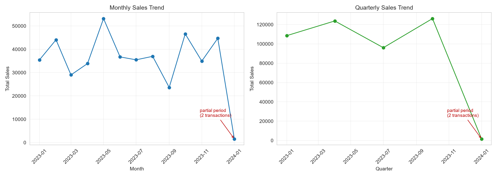
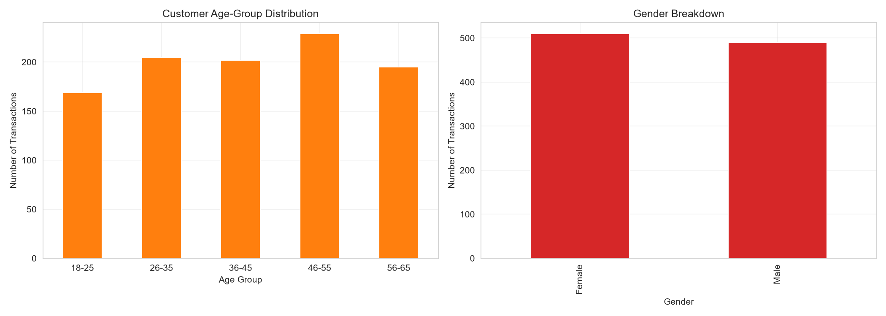
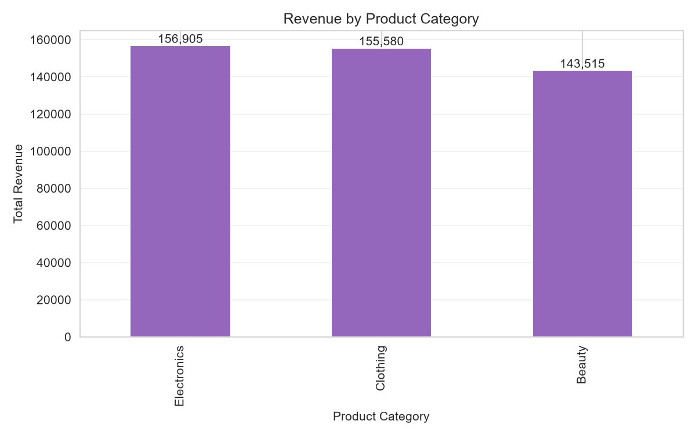
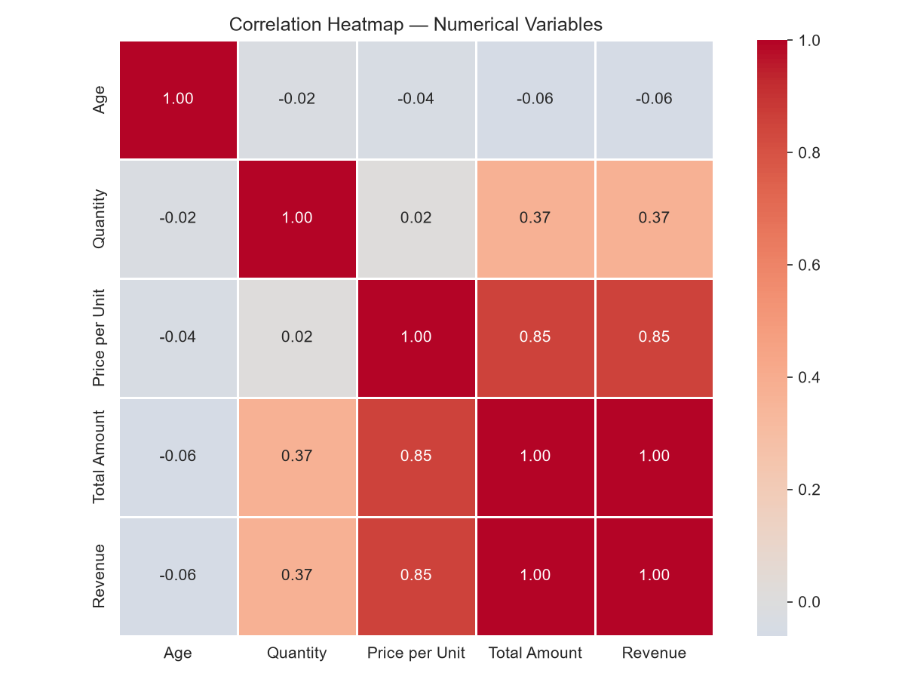
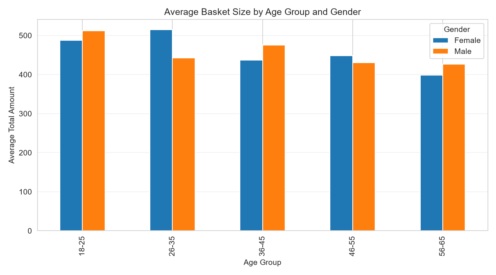

# EDA Report — Retail Sales

**Project:** `DataAnalytics-L1-EDARetailSales`
**Notebook:** [`../notebooks/retail_sales_eda.ipynb`](../notebooks/retail_sales_eda.ipynb)
**Dataset:** 1,000 retail transactions · `data/raw/retail_sales.csv`

Every figure in this report is produced by the notebook and reproduced in
[`../outputs/figures/`](../outputs/figures/).

---

## 1. Data quality

The raw file is **1,000 rows × 9 columns** with **no null values** and **no duplicate rows**. The validation pass confirmed:

| Check | Result |
|---|---|
| Duplicate rows | 0 |
| `Total Amount ≠ Quantity × Price per Unit` | 0 rows |
| `Quantity ≤ 0` | 0 rows |
| `Price per Unit ≤ 0` | 0 rows |
| `Total Amount ≤ 0` | 0 rows |
| `Age` outside 18–100 | 0 rows |

The cleaning pipeline (parse dates → drop duplicates → drop invalid rows → recompute `Total Amount` → add an independent
`Revenue` column) therefore removed **0 rows**, and the cleaned dataset is 1,000 × 15. The pipeline is retained because it is
what *demonstrates* the data is clean rather than assuming it.

## 2. Descriptive statistics (every numeric column)

| Column | mean | median | mode | std | min | max |
|---|---:|---:|---:|---:|---:|---:|
| `Transaction ID` | 500.50 | 500.5 | 1.0 | 288.82 | 1 | 1000 |
| `Age` | 41.39 | 42.0 | 43.0 | 13.68 | 18 | 64 |
| `Quantity` | 2.51 | 3.0 | 4.0 | 1.13 | 1 | 4 |
| `Price per Unit` | 179.89 | 50.0 | 50.0 | 189.68 | 25 | 500 |
| `Total Amount` | 456.00 | 135.0 | 50.0 | 560.00 | 25 | 2000 |

`Price per Unit` is strongly right-skewed: the mean (179.89) is 3.6× the median (50.0), because a minority of transactions sit
at the 500 price point.

## 3. Time series

Total revenue **456,000** over 1,000 transactions.

- Best full month **May 2023: 53,150** (105 transactions). Weakest full month **September 2023: 23,620** (65 transactions) —
  a **2.25×** spread.
- Secondary peaks in February (44,060) and December (44,690) — a recurring seasonal lift, not a single spike.
- Quarterly: **Q1 108,500 → Q2 123,735 → Q3 96,045 → Q4 126,190**. Q3 is **22.4% below Q2**; Q4 is the strongest quarter.
- The final point (**2024-01, 1,530 from 2 transactions**) is a **partial period** and is annotated on the chart.

## 4. Demographics

| Age group | Transactions |  | Gender | Transactions |
|---|---:|---|---|---:|
| 18–25 | 169 | | Female | 510 (51%) |
| 26–35 | 205 | | Male | 490 (49%) |
| 36–45 | 202 | | | |
| 46–55 | 229 | | | |
| 56–65 | 195 | | | |

Both dimensions are flat. There are **1,000 unique customer IDs for 1,000 transactions** — every customer appears exactly once,
so demographics here are transaction counts.

## 5. Best sellers

**Basis: total quantity sold, cross-checked against total revenue.** The dataset exposes products at *category* level only
(3 categories, no product names), so the "top 10" list resolves to 3 rows.

| Category | Units sold | Revenue | Share of revenue |
|---|---:|---:|---:|
| Electronics | 849 | **156,905** | 34.4% |
| Clothing | **894** | 155,580 | 34.1% |
| Beauty | 771 | 143,515 | 31.5% |

The rankings disagree: Clothing leads on units, Electronics on revenue.

## 6. Revenue by category

A flat split — the top and bottom categories differ by only **13,390, or 2.9 percentage points** of 456,000. Category mix is not
the lever on this dataset.

## 7. Correlations

| Pair | r | Note |
|---|---:|---|
| `Price per Unit` ↔ `Total Amount` | **0.852** | Structural: `Total Amount = Quantity × Price per Unit` |
| `Revenue` ↔ `Total Amount` | **1.000** | Same quantity — confirms the recomputation is consistent |
| `Quantity` ↔ `Total Amount` | 0.374 | Moderate; price varies far more than quantity |
| `Age` ↔ everything | −0.061 … −0.024 | Essentially uncorrelated |

No meaningful negative correlations appear, so there is no trade-off structure in this dataset.

## 8. Extra visualisation — basket size

| Avg. basket | Female | Male |
|---|---:|---:|
| 18–25 | 487.28 | 512.27 |
| 26–35 | **515.09** | 442.50 |
| 36–45 | 436.78 | 475.11 |
| 46–55 | 447.98 | 430.73 |
| 56–65 | **398.02** | 426.26 |

Average basket value spans **398.02–515.09**, a **29% spread**, while transaction counts stay nearly flat. The gender gap
**reverses by age** — women lead in 26–35 and 46–55, men in 18–25, 36–45 and 56–65. The age ordering is not monotonic, and
56–65 is the weakest band for both genders.

**The non-obvious insight:** revenue is driven by *how much customers spend per transaction*, not by *how many transactions they
make*.

## 9. Recommendations

1. **Re-price and re-bundle around unit price, not around volume.** Price correlates with basket value at 0.852 vs 0.374 for
   quantity; bundle the 500-unit-price lines (68 Beauty, 67 Electronics, 64 Clothing transactions) with low-price items.
2. **Plan stock and campaigns around the Q3 trough and the Q4 peak.** Q3 is 22.4% below Q2; run a July–September
   traffic-and-volume promotion rather than a pricing cut, and build inventory ahead of the Q4 lift.
3. **Grow basket value in the weakest cells (Female 56–65 at 398.02, Male 56–65 at 426.26) and drop age as a targeting key.**
   The gender split is 2% of transactions and the age spread 6% of volume, against a 29% spread in basket value.

## 10. Limitations

- Products exist only at category level, so a genuine top-10 *product* list is not possible from this file.
- One transaction per customer — no repeat-purchase or lifetime analysis is possible.
- The 2023 monthly totals swing with no marketing, price or competitor context in the file, so no cause can be attributed.
- The final period (2024-01-01, 2 transactions) is partial and must be excluded from seasonal readings.
- All results describe associations within these 1,000 rows; none implies causation.
